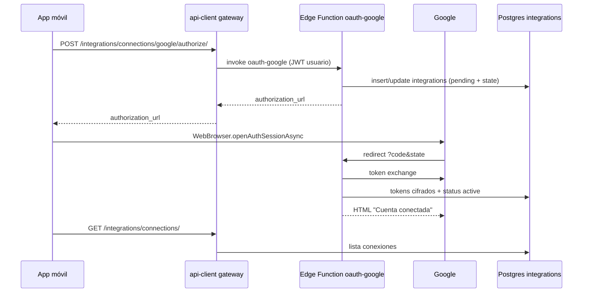

# Integraciones Google / Microsoft (solo Supabase)

Esta guía es para **desarrolladores**. Buddy usa **solo Supabase** como backend. El flujo del monorepo es:

1. La app (`@beeapp/api-client`) enruta las APIs a **Postgres + Auth de Supabase** (`supabaseGateway`).
2. **OAuth** lo hacen las **Edge Functions** `oauth-google` y `oauth-microsoft`.
3. Los tokens cifrados se guardan en la tabla **`public.integrations`**.
4. **Sincronización** de correo/calendario: funciones `mail-sync` y `calendar-sync` (y/o cron que las invoque).

Necesitas secretos en el proyecto Supabase y apps registradas en Google Cloud y Microsoft Entra.

---

## 1. Requisitos en Supabase

### 1.1 Esquema

Aplica las migraciones del repo (`database/migrations/`), en especial la tabla `integrations` (`0001_core.sql`).

Documentación: [Database migrations](https://supabase.com/docs/guides/deployment/database-migrations)

### 1.2 Desplegar Edge Functions

Desde la raíz del monorepo (con [Supabase CLI](https://supabase.com/docs/guides/cli)):

```bash
supabase link --project-ref TU_PROJECT_REF
supabase functions deploy oauth-google
supabase functions deploy oauth-microsoft
supabase functions deploy mail-sync
supabase functions deploy calendar-sync
```

Guía: [Deploy Edge Functions](https://supabase.com/docs/guides/functions/deploy)

### 1.3 Secretos (Dashboard → Project Settings → Edge Functions → Secrets)

| Secreto | Obligatorio | Descripción |
|---------|-------------|-------------|
| `GOOGLE_OAUTH_CLIENT_ID` | Sí | Client ID OAuth web de Google |
| `GOOGLE_OAUTH_CLIENT_SECRET` | Sí | Client secret |
| `GOOGLE_OAUTH_REDIRECT_URI` | Recomendado | Ver §2.1. Si no se define, usa `{SUPABASE_URL}/functions/v1/oauth-google` |
| `MICROSOFT_OAUTH_CLIENT_ID` | Sí | Application (client) ID de Entra |
| `MICROSOFT_OAUTH_CLIENT_SECRET` | Sí | Client secret |
| `MICROSOFT_OAUTH_REDIRECT_URI` | Recomendado | Ver §3.1. Por defecto `{SUPABASE_URL}/functions/v1/oauth-microsoft` |
| `INTEGRATION_TOKEN_KEY` | Sí | Cadena larga y aleatoria (≥ 32 caracteres) para cifrar tokens en BD (AES-GCM en la función). **No** es la anon key. |

`SUPABASE_URL`, `SUPABASE_ANON_KEY` y `SUPABASE_SERVICE_ROLE_KEY` las inyecta Supabase en runtime; no hace falta duplicarlas salvo pruebas locales.

Doc secretos: [Edge Function secrets](https://supabase.com/docs/guides/functions/secrets)

### 1.4 App móvil

En `Fronted/apps/mobile/.env`:

```env
EXPO_PUBLIC_SUPABASE_URL=https://TU_PROJECT_REF.supabase.co
EXPO_PUBLIC_SUPABASE_ANON_KEY=eyJ...
```

La app abre directamente la `authorization_url` de Google/Microsoft que devuelven las Edge Functions; no hace falta ninguna otra variable.

---

## 2. Google Cloud

### 2.1 Consola y APIs

1. [Google Cloud Console](https://console.cloud.google.com/)
2. [OAuth consent screen](https://support.google.com/cloud/answer/10311615)
3. Habilitar:
   - [Gmail API](https://console.cloud.google.com/apis/library/gmail.googleapis.com)
   - [Google Calendar API](https://console.cloud.google.com/apis/library/calendar-json.googleapis.com)

### 2.2 Cliente OAuth “Aplicación web”

[Crear credenciales OAuth](https://developers.google.com/identity/protocols/oauth2/web-server#creatingcred)

**URI de redirección autorizada** (debe coincidir con `GOOGLE_OAUTH_REDIRECT_URI` o el default):

```text
https://TU_PROJECT_REF.supabase.co/functions/v1/oauth-google
```

### 2.3 Scopes usados por `oauth-google`

Definidos en `database/functions/oauth-google/index.ts`:

- `openid`, `email`, `profile`
- `https://www.googleapis.com/auth/gmail.readonly`
- `https://www.googleapis.com/auth/gmail.send`
- `https://www.googleapis.com/auth/calendar.readonly`
- `https://www.googleapis.com/auth/calendar.events`

Referencia: [Gmail scopes](https://developers.google.com/gmail/api/auth/scopes), [Calendar scopes](https://developers.google.com/calendar/api/guides/auth)

---

## 3. Microsoft Entra (Azure)

### 3.1 Registro de aplicación

1. [App registrations](https://entra.microsoft.com/#view/Microsoft_AAD_RegisteredApps/ApplicationsListBlade)
2. [Quickstart: Register an app](https://learn.microsoft.com/en-us/entra/identity-platform/quickstart-register-app)
3. Tipo de cuenta: **multitenant + personal** (`common`), coherente con la URL de autorización de la función.

**Redirect URI (Web)**:

```text
https://TU_PROJECT_REF.supabase.co/functions/v1/oauth-microsoft
```

Doc: [Redirect URI](https://learn.microsoft.com/en-us/entra/identity-platform/reply-url)

### 3.2 Secreto de cliente

[Add a client secret](https://learn.microsoft.com/en-us/entra/identity-platform/howto-add-credentials)

### 3.3 Permisos delegados (Microsoft Graph)

En la función (`oauth-microsoft/index.ts`): `offline_access`, `openid`, `email`, `profile`, `User.Read`, `Mail.Read`, `Mail.Send`, `Calendars.ReadWrite`.

[Permisos de Graph](https://learn.microsoft.com/en-us/graph/permissions-reference)

Cuentas corporativas: [Consentimiento de administrador](https://learn.microsoft.com/en-us/entra/identity/enterprise-apps/grant-admin-consent)

---

## 4. Flujo técnico (resumen)



---

## 5. Sincronización mail / calendario

- Después de conectar, el usuario usa **Correos externos** / **Calendarios externos** en la app.
- Las funciones `mail-sync` y `calendar-sync` usan los mismos secretos OAuth + `INTEGRATION_TOKEN_KEY` para refrescar tokens.

Programar invocaciones periódicas (pg_cron, GitHub Actions, etc.): [Scheduling Edge Functions](https://supabase.com/docs/guides/functions/schedule-functions)

---

## 6. Comprobación

1. Secretos cargados en Supabase (sin `GOOGLE_OAUTH_NOT_CONFIGURED` al conectar).
2. Redirect URIs exactas en Google/Microsoft.
3. Usuario autenticado en la app (JWT válido al invocar la función).
4. Tras OAuth, fila en `integrations` con `status = active` y `access_token_ciphertext` no nulo.

---

## 7. Final del callback (resuelto)

En el dominio por defecto de Supabase (`*.supabase.co`) las respuestas `GET` con `text/html` se reescriben a `text/plain` ([Routing](https://supabase.com/docs/guides/functions/http-methods), [Limits](https://supabase.com/docs/guides/functions/limits)), por eso las funciones **ya no devuelven HTML**.

Desde la versión 5 de `oauth-google` y `oauth-microsoft`, el callback responde con un `302` a:

- `beeapp://integrations/result?outcome=success` si la cuenta se conectó.
- `beeapp://integrations/result?outcome=failure&detail=...` si algo falló (enlace vencido, acceso denegado, error al intercambiar el código o secretos sin configurar).

`WebBrowser.openAuthSessionAsync` cierra el navegador al detectar ese esquema y la app abre `app/integrations/result.tsx`, que vuelve a Integraciones.

El esquema `beeapp` debe coincidir con `scheme` en `app.json`. Funciona en builds de desarrollo y producción; en Expo Go el esquema sería distinto (`exp://`).